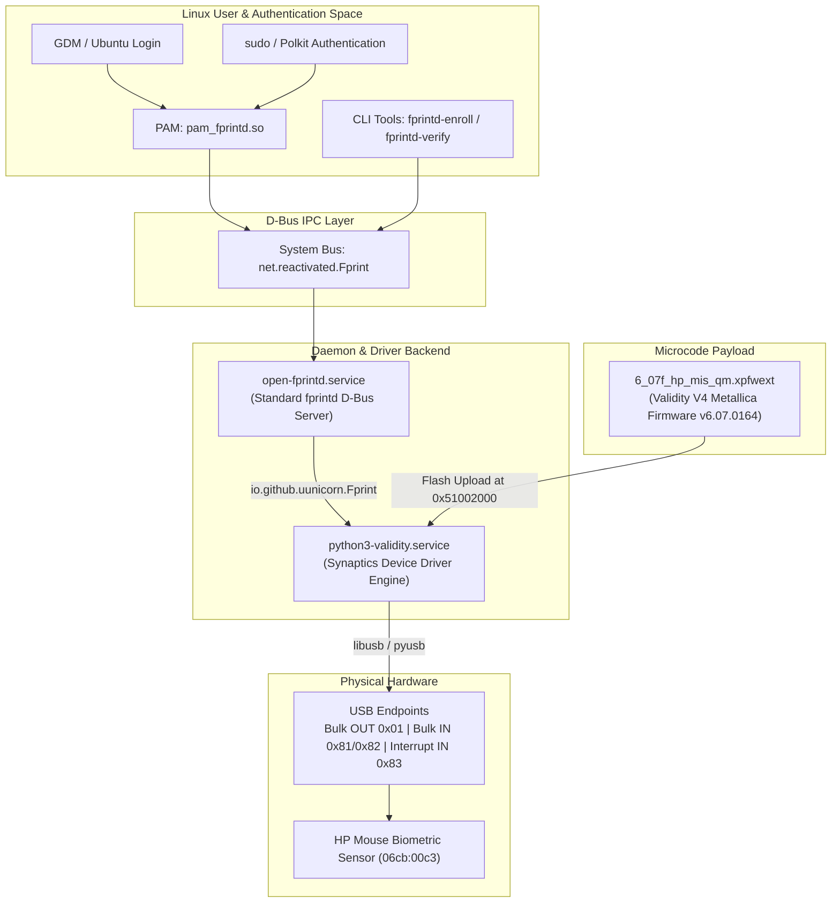

# HP USB Fingerprint Mouse - Linux (Ubuntu / Debian) Driver & Support

This repository contains the native Linux biometric driver, microcode firmware loader, udev rules, D-Bus bridging daemons, and Debian installation package for the **HP USB Fingerprint Mouse**.

---

## 1. Hardware Architecture Overview

Inside a single USB cable and housing, this device is composed of two independent hardware components connected via an internal USB 2.0 hub:

| Component | Hardware ID | Linux Subsystem & Driver |
| :--- | :--- | :--- |
| **Optical Mouse** | `USB\VID_03F0&PID_4B4A` | Standard Linux HID kernel module (`usbhid` / `evdev`) |
| **Biometric Sensor** | `USB\VID_06CB&PID_00C3` | Synaptics Metallica Match-In-Sensor (MIS) capacitive touch sensor |

---

## 2. Software Architecture on Linux

Windows uses Windows Biometric Framework (WBF) and Intel SGX (`synaTEE106.signed.dll`). Under Linux, proprietary SGX enclaves cannot run directly, but the sensor itself is a **Match-In-Sensor (MIS)** chip capable of performing capacitive frame capture, calibration, and template matching autonomously once loaded with the authentic Synaptics microcode firmware (`6_07f_hp_mis_qm.xpfwext`).



---

## 3. Installation Methods

### Method 1: Install via Debian Package (`.deb`) — Recommended

The pre-built Debian package bundles all dependencies, udev rules, systemd units, firmware payloads, and binaries:

```bash
cd /home/aziyan/Desktop/hobby/HP_Fingerprint_Mouse_Driver/hp-fingerprint-mouse-linux
sudo dpkg -i hp-fingerprint-mouse-support_1.0-1_all.deb
sudo apt-get install -f  # (optional: resolves any missing dependencies automatically)
```

### Method 2: Install via Automated Shell Script (Ubuntu / Debian)

Alternatively, you can run the turnkey installation script directly:

```bash
cd /home/aziyan/Desktop/hobby/HP_Fingerprint_Mouse_Driver/hp-fingerprint-mouse-linux
sudo ./install.sh
```

### Method 3: Install on Arch Linux

On Arch Linux, run the dedicated Arch installer (uses `pacman` to install dependencies and configures systemd / udev):

```bash
cd /home/aziyan/Desktop/hobby/HP_Fingerprint_Mouse_Driver/hp-fingerprint-mouse-linux
sudo ./install-arch.sh
```

Or build with `makepkg` using `arch/PKGBUILD`:
```bash
cd /home/aziyan/Desktop/hobby/HP_Fingerprint_Mouse_Driver/hp-fingerprint-mouse-linux/arch
makepkg -si
```

---

## 4. How to Enroll & Use Your Fingerprint

### Step 1: Enroll Your Finger
Run standard `fprintd` enrollment from your terminal:

```bash
fprintd-enroll
```
*When prompted, place your finger on the sensor located on the mouse surface repeatedly (around 5 to 10 touches) until enrollment is 100% complete.*

To enroll a specific finger (e.g. right index finger):
```bash
fprintd-enroll -f right-index-finger
```

### Step 2: Verify Your Fingerprint
Test that the sensor successfully verifies your print:

```bash
fprintd-verify
```
*Touch the sensor on your mouse. You should see `Verify result: verify-match (done)`.*

### Step 3: Enable Fingerprint for `sudo` and System Auth
Ensure that PAM has fingerprint authentication enabled:

```bash
sudo pam-auth-update
```
*(Ensure `[*] Fingerprint authentication` is checked with the spacebar, then press Tab and Enter to Save).*

Now whenever `sudo` requests your password, you can simply tap the fingerprint sensor on your mouse!

---

## 5. Diagnostic & Testing Tool

A hardware diagnostic tool `test_hp_mouse.py` is included in this directory and installed system-wide as `hp-mouse-test`:

```bash
# Run local diagnostic:
python3 test_hp_mouse.py

# Or if installed as root/deb:
hp-mouse-test
```

It inspects:
1. Physical USB detection of both Mouse HID and Sensor endpoints.
2. Device file read/write permissions on `/dev/bus/usb/`.
3. Sensor ROM version, TLS communication channel, and firmware flash state.
4. Active D-Bus services and registered devices.

---

## 6. How to Uninstall

If you ever wish to remove the driver and restore stock settings:

```bash
# If installed via .deb:
sudo dpkg -r hp-fingerprint-mouse-support

# Or via script:
cd /home/aziyan/Desktop/hobby/HP_Fingerprint_Mouse_Driver/hp-fingerprint-mouse-linux
sudo ./uninstall.sh
```

This will automatically unmask and restore standard Ubuntu `fprintd.service`, remove custom udev rules, and clean up daemon binaries.
